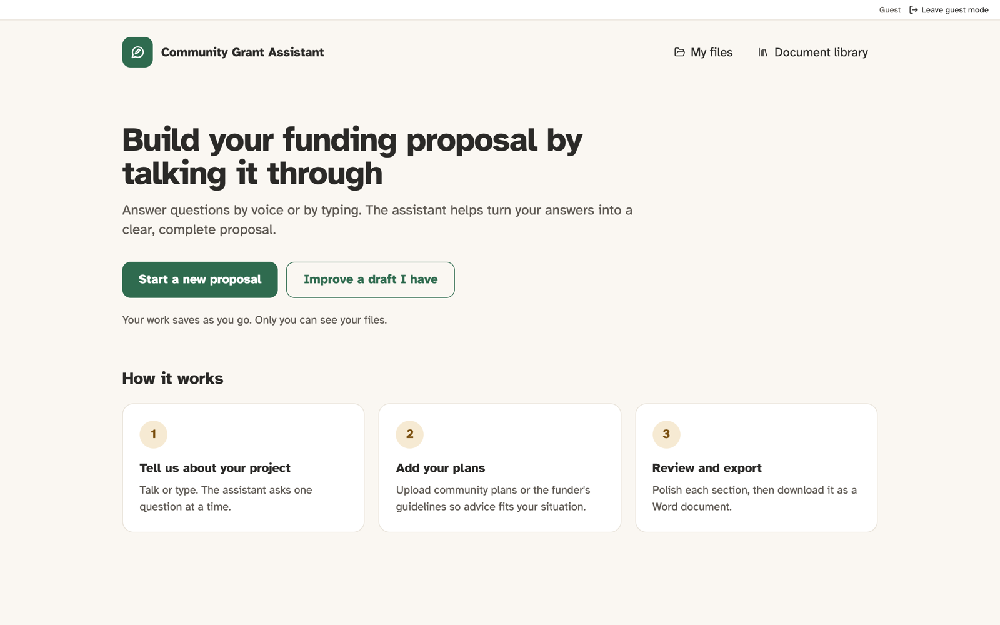
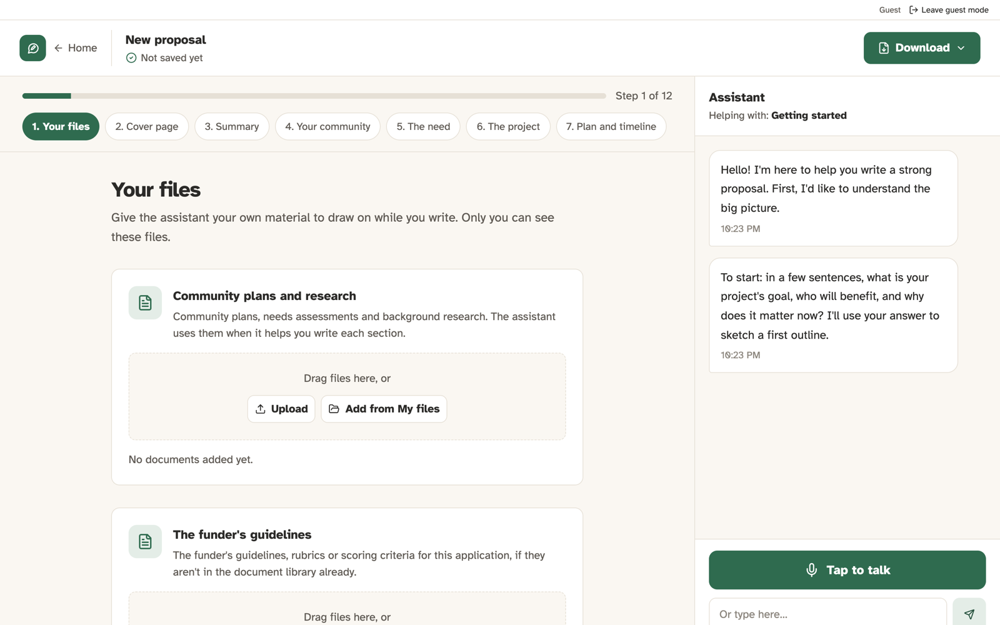

# VoiceFirst

**Build a funding proposal by talking it through.**

VoiceFirst helps communities write grant proposals. You answer questions by voice or by typing, and the assistant turns your answers into a clear, complete proposal that you can download as a Word document.





## What it does

- **Voice or text conversation.** The assistant asks one question at a time. You can speak your answers and hear its replies, powered by ElevenLabs speech-to-text and text-to-speech.
- **Guided proposal builder.** Twelve steps cover the usual sections of a proposal: cover page, summary, community, need, project, plan and timeline, budget, results, fit with the funder, risks and attachments. Details you give in the chat are filled into the right fields.
- **Draft check.** Upload a proposal you've already written. You get a score and feedback for each section, and you can use it to fill in the builder.
- **Answers grounded in your documents.** Upload community plans or a funder's guidelines. The assistant looks up the relevant passages and cites them in its replies. There is also a shared library that admins manage.
- **Saved proposals and files.** Your work saves as you go and only you can see it. You can export a proposal as a `.docx` file, or as a zip that includes its attachments.
- **Sign-in and guest access.** Users sign in with an email link through Supabase Auth. Guests and accounts that aren't on the full-access list can use the app with usage limits.

## How it works

```
frontend/   Next.js 14 + Tailwind, exported as a static site
backend/    FastAPI app that serves the /api endpoints
docs/       Screenshots for this README
```

- **Chat:** each turn runs through a small [LangGraph](https://github.com/langchain-ai/langgraph) graph: *classify → retrieve → answer → fill fields → speak*. A TypeSafe Jev model scores whether the turn needs real writing or advice. Turns that do go to a stronger OpenAI model, and the rest go to a faster one.
- **Retrieval:** documents are split into chunks, embedded with OpenAI, and stored in Supabase Postgres with `pgvector`. The original files are kept in Supabase Storage.
- **Storage:** proposals, files and usage counts live in the same Postgres database. The tables are created automatically on first start.

## Running it locally

You'll need Python 3.12, Node.js 20, and accounts with OpenAI, ElevenLabs and Supabase.

### 1. Configure

```bash
cp .env.example .env
```

Fill in the keys in `.env`. The backend reads this file on startup. For local development you can set `AUTH_DISABLED=true` to use the API without signing in. Never set it on a deployed server.

### 2. Backend

```bash
cd backend
python3 -m venv .venv
source .venv/bin/activate
pip install -r requirements.txt
uvicorn app.main:app --reload
```

The API runs at `http://127.0.0.1:8000`, and the interactive docs are at `http://127.0.0.1:8000/docs`.

### 3. Frontend

```bash
cd frontend
npm install
npm run dev
```

Open `http://localhost:3000`. If the API isn't at `http://127.0.0.1:8000/api`, set `NEXT_PUBLIC_API_BASE_URL` in `frontend/.env.local`.

### Tests

```bash
pip install -r backend/requirements-dev.txt
python -m pytest
```

The knowledge-base tests also need a Postgres database with `pgvector`, set in `TEST_DATABASE_URL`. Without it they are skipped. CI runs them against a temporary `pgvector/pgvector` container.

## Configuration

| Variable | Purpose |
| --- | --- |
| `OPENAI_API_KEY` | Chat, draft analysis and embeddings |
| `ELEVENLABS_API_KEY` | Speech-to-text and text-to-speech |
| `SUPABASE_URL`, `SUPABASE_SERVICE_KEY`, `SUPABASE_DB_URL` | File storage and the Postgres database. Without them, the document and file endpoints return 503. |
| `NEXT_PUBLIC_SUPABASE_URL`, `NEXT_PUBLIC_SUPABASE_PUBLISHABLE_KEY` | Sign-in on the website (public values) |
| `LIBRARY_ADMIN_EMAILS` | Emails that can manage the shared library |
| `FULL_ACCESS_EMAILS` | Emails that have no usage limits |
| `TYPESAFE_API_KEY` | Turns on the chat router. Without it, every turn uses `OPENAI_CHAT_MODEL`. |
| `CORS_ALLOW_ORIGINS` | Frontend origins allowed to call the API |
| `AUTH_DISABLED` | `true` skips sign-in. For local use only. |

Models, voice, chunking and retrieval can all be tuned. See [`.env.example`](.env.example) for every option and its default.

## Deployment

GitHub Actions deploys on every push to `main`:

- The backend goes to Azure App Service (`.github/workflows/main_voice-first-backend.yml`).
- The frontend is built as a static export and goes to Azure Static Web Apps (`.github/workflows/frontend-static-web-app.yml`).

`.github/workflows/ci.yml` runs the backend tests and the frontend type check and build on every pull request.

## License

[MIT](LICENSE). See [Attributions.md](Attributions.md) for third-party components.
